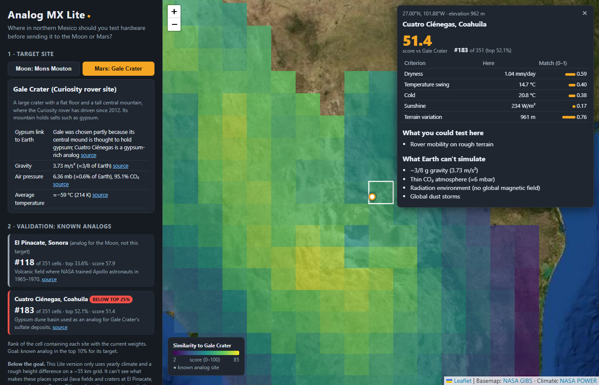

# Analog MX Lite

**Where in Mexico should you test hardware before sending it to the Moon or Mars?**

Analog MX Lite is a simple map that gives each patch of northern Mexico a score from 0 to 100 for how much it is like a future landing site: the **Mons Mouton** plateau near the Moon's south pole (an Artemis III candidate region) or **Gale Crater** on Mars (Curiosity's site). It is a basic version of [Analog MX](https://github.com/AVIVVVVVV/analog-mx). It only uses data that anyone could collect without working in space exploration: yearly climate and elevation from NASA POWER.

**Live site:** https://avivvvvvv.github.io/analog-mx-lite/



## Run it

```
pip install -r requirements.txt
python pipeline/build_cells.py     # builds web/cells.json (run pipeline/fetch_power.py first if data/raw/power/ is empty)
python -m http.server -d web 8000  # open http://localhost:8000
```

`python pipeline/validate.py` prints the rank of the two known analog sites (needs Node.js).

**Sources:** Climate and elevation: NASA POWER. Basemap: NASA GIBS. Moon/Mars facts: NASA fact sheets. Mexico border: Natural Earth.

## How the score works

Each map cell is one NASA POWER grid point (0.5° × 0.625°, about 55 km). Five criteria are scored by how a cell ranks against all other cells in the region (0 = least like the Moon/Mars, 1 = most): **Dryness** (less rain), **Temperature swing** (bigger day–night difference), **Cold** (lower average temperature), **Sunshine** (more sun) and **Terrain variation** (bigger height difference between the cell and its neighbours). The score is the weighted average of the five, times 100. You can change the weights with sliders. The default weights depend on the target. The lunar site is a mountainous plateau, so terrain counts fully. Gale is a crater with a flat floor and one central mountain, so terrain counts half and sunshine less.

## Validation

We check two places NASA has already used as analogs. The goal was to get each one into the top 10% for its target.

| Site | Target | Plan weights | After one adjustment (Cold = 0) |
|---|---|---|---|
| El Pinacate, Sonora | Moon | #195 of 351 (top 55.6%) | **#121 of 351 (top 34.5%)** |
| Cuatro Ciénegas, Coahuila | Mars | #222 of 351 (top 63.2%) | **#183 of 351 (top 52.1%)** |

**Neither site reaches the goal.** We checked that each criterion points the right way. Then we made one weight change, as the project plan allows: Cold is set to 0 for both targets. No place on Earth is anywhere near as cold as the Moon or Mars, so this criterion was mostly pointing at the high mountains. Both sites are still below the goal, and the app says so. The reason is simple: on a ~55 km grid, yearly climate and a rough height difference can't capture what makes these places special. El Pinacate has lava fields and craters, and Cuatro Ciénegas has gypsum dunes. The full Analog MX version, which uses detailed elevation models, put Cuatro Ciénegas in the top 5.1% for Mars.

## Limitations

1. Cells are big (~55 km), so dune fields, craters and other small features disappear.
2. "Terrain variation" is only the height difference between neighbouring grid points. It is not slope and says nothing about rocks or soil.
3. All criteria are relative to northern Mexico. No place on Earth gets close to the Moon's or Mars's temperatures, air pressure or gravity.

## Credits

Built for the NASA Space Apps Challenge 2026. Code written with the help of Claude Code (AI coding assistant), reviewed by the team. Every number comes from NASA POWER or a linked NASA source. No NASA endorsement is implied.
